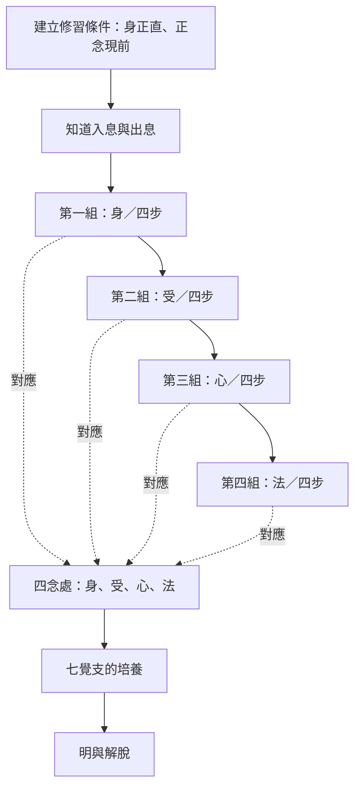

本圖整理 MN 118 的教法骨架：從穩定的修習條件與對入出息的覺知，進入四組十六步，再與四念處、七覺支及解脫方向相連。它是概念地圖，不代表每位修行者都必須照著固定時間表逐項完成。

## 延伸筆記
- [[MN118入出息念經以四組十六步整合四念處]]
- [[SN54入出息相應顯示呼吸念是持續修行主題]]
- [[十六步把同一呼吸所緣展開為身受心法]]
- [[四組練習讓呼吸成為完整修道的入口]]
- [[無常離貪滅盡捨離把呼吸覺察導向解脫]]
- [[四念處是身受心法四個覺察領域]]
- [[七覺支是導向覺悟的七種心靈品質]]

## 對照閱讀
- [[入出息念經是呈現十六步修行綱要的中部經典]]
- [[正念是記得並持續照看當下所緣的心智能力]]
- [[法是可被辨識與觀察的身心現象及修道原則]]

---

回到全書導讀：[[Ānāpānasati]]
