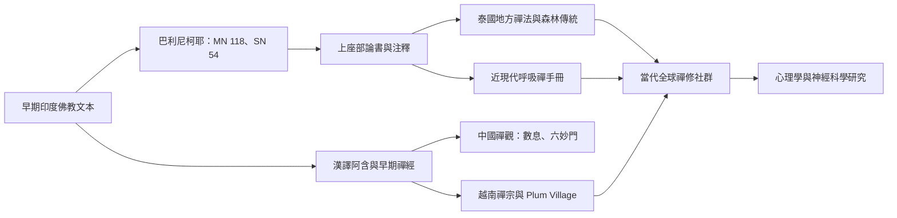

這張地圖把早期巴利經典、漢譯阿含、印度與中國禪經、上座部論書、近現代泰國／緬甸／越南傳承及跨學科研究放在同一張歷史關係圖中。連線表示研究上可比較的脈絡，不代表單線傳承或直接影響關係。

## 重要文獻
- [[漢譯雜阿含保留入出息念的另一種傳承脈絡]]
- [[Anālayo以雜阿含經校讀十六步呼吸念]]
- [[Sembo指出巴利經藏中的呼吸念存在多種系統]]
- [[陳英善以安般念重建中國早期禪法的多重層次]]
- [[解脫道論與清淨道論呈現呼吸禪的不同論釋]]
- [[泰國古傳禪法保留不同於現代主流的呼吸禪路徑]]
- [[Buddhadasa以十六步呼吸念重新解讀佛陀教法]]
- [[Thich Nhat Hanh把十六步呼吸念帶入日常行動]]

## 研究原則
- [[早期經典與後期論書不宜混為單一標準流程]]
- [[呼吸所緣的位置與方法會隨傳承而改變]]
- [[巴利與漢譯的差異應視為研究線索而非錯誤清單]]

---

回到全書導讀：[[Ānāpānasati]]
