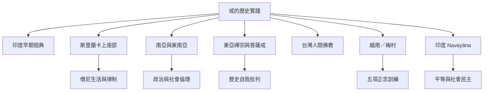

這張地圖把印度經典、斯里蘭卡上座部僧俗實踐、南亞與東南亞社會倫理、東亞禪宗及台灣人間佛教、越南梅村傳統，以及印度 Navayāna 的現代詮釋放在同一個比較框架。比較時要標示地域、年代、研究方法及材料層次，避免用單一傳統代表所有佛教。

閱讀入口：[[閱讀佛教倫理應同時追蹤經典思想與地方實踐]]、[[佛教倫理具有個人修習與公共實踐兩個尺度]]、[[佛教倫理必須接受歷史檢驗與自我批判]]。

資料入口：[[善生經把在家倫理寫成六方互惠關係]]、[[斯里蘭卡僧尼研究指出戒律實踐不能化約為規則數量]]、[[南亞與東南亞佛教倫理兼有政治救度與社會參與面向]]、[[禪宗戒學需放回戰爭性別與環境等歷史情境理解]]、[[星雲大師以尊重生命身體名譽與理智詮釋五戒]]、[[梅村五項正念訓練把五戒改寫成涵蓋生活世界的倫理承諾]]、[[Navayana研究把佛法重構為平等博愛與社會民主的倫理工程]]。

訪談與第一人稱材料：[[一行禪師訪談將五項正念訓練定位為面向不同信仰的全球倫理]]、[[一行禪師與美國警官的對談呈現戒在職業暴力情境中的實踐張力]]、[[達摩難陀比丘尼訪談強調理解毘奈耶的精神而非機械遵循文字]]、[[泰國傳承僧人Phra Anil Sakya訪談將戒理解為倫理自我教育]]、[[佛使比丘訪談將正命根植於正見與不自私]]、[[比丘Anālayo訪談呈現不同上座部地區對素食的生活差異]]。
