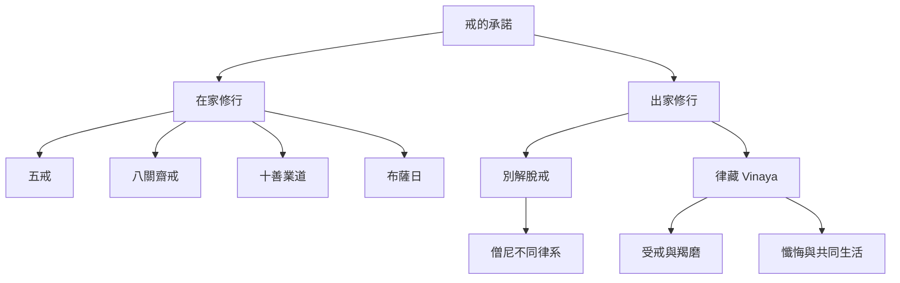

這張地圖比較在家人的五戒、八戒、十善與出家眾的別解脫戒及律藏制度。關鍵不是比較誰持守更多條目，而是理解每種承諾所對應的生活角色、修行目標與共同體責任。

閱讀入口：[[戒的規範強度取決於修行角色與受戒制度]]、[[戒的實踐不能只用規則條數衡量]]、[[毘奈耶既是僧團制度也是共同生活的訓練]]、[[八戒把日常生活轉化為週期性的集中訓練]]。

概念入口：[[Sikkhāpada（學處）]]、[[Pañca-sīla（五戒）]]、[[Aṣṭāṅga-upavāsa（八關齋戒）]]、[[Daśa-kuśala-karmapatha（十善業道）]]、[[Vinaya（毘奈耶）]]、[[Prātimokṣa（別解脫戒）]]、[[Uposatha（布薩）]]、[[Saṅgha（僧伽）]]。
