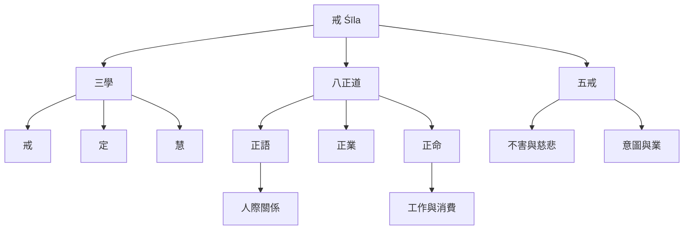

這張地圖整理戒如何進入佛教修行的整體架構：戒定慧三學、八正道戒蘊、五戒、正語正業正命，以及意圖、業與慈悲之間的關係。讀者可由八正道理解戒的功能，再透過經典與永久筆記檢查其日常意義。

閱讀入口：[[戒是覺醒道路的倫理基礎而不是禪修之外的附屬規條]]、[[戒定慧是互相支持的訓練系統]]、[[五戒把不害轉化為可檢驗的生活承諾]]、[[正語正業正命讓修行進入日常社會關係]]。

概念入口：[[Śīla（戒）]]、[[Triśikṣā（三學）]]、[[Āryāṣṭāṅgamārga（八正道）]]、[[Pañca-sīla（五戒）]]、[[Sammā-vācā（正語）]]、[[Sammā-kammanta（正業）]]、[[Sammā-ājīva（正命）]]、[[Karma（業）]]、[[Kuśala（善／善巧）]]。
