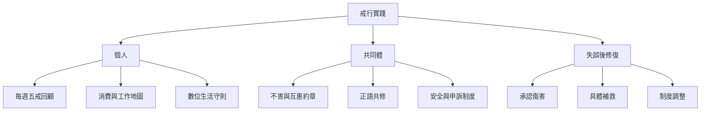

這張地圖將戒學轉化為可持續的行動設計：個人定期回顧、共修團體約章、正語練習、消費與工作地圖、失誤修復，以及正念活動的倫理說明。重點是讓承諾可觀察、可回饋、可修正，也不以羞恥或權威控制成員。

行動入口：[[把五戒轉化成每週一次的無評判生活回顧]]、[[為共修團體建立一份不害與互惠的共同生活約章]]、[[設計一個結合靜坐與正語練習的共修晚間]]、[[讓戒行失誤之後的修復成為正式修行環節]]。

概念入口：[[Śīla（戒）]]、[[Sikkhāpada（學處）]]、[[Saṅgha（僧伽）]]、[[Sammā-vācā（正語）]]、[[Sammā-ājīva（正命）]]。
