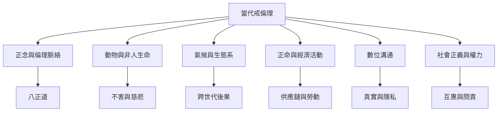

這張地圖整理戒如何回應當代正念課程、動物倫理、氣候危機、工作與消費、數位溝通及社會正義。它將佛教的倫理動機與當代科學、社會研究及制度分析連接，避免只用個人善意處理結構問題。

閱讀入口：[[正念若與戒分離容易變成價值中立的注意力技術]]、[[不殺生必須檢視間接參與與供應鏈傷害]]、[[生態戒倫理必須看見非有情自然物與系統性後果]]、[[正命需要檢視消費與生產背後的傷害]]、[[倫理修行必須檢視制度與權力的不對等]]。

行動入口：[[把正命做成一張日常消費與工作傷害地圖]]、[[將動物慈悲練習延伸到食物與物品的來源追蹤]]、[[為正念工作坊補上一段倫理目的與界線說明]]、[[把五戒翻譯成數位生活的個人與社群守則]]。
