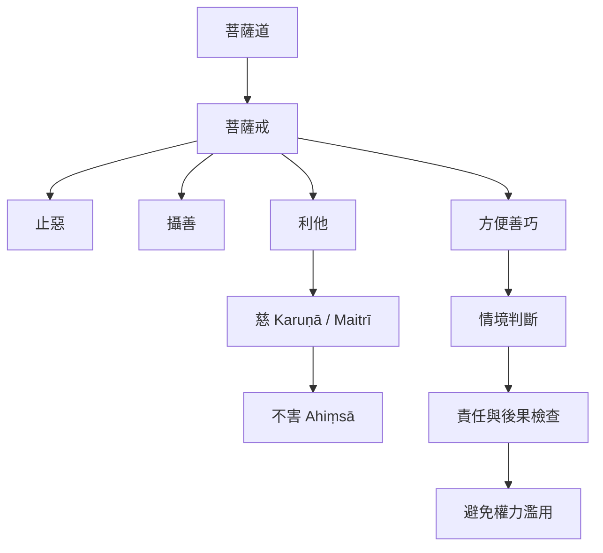

這張地圖聚焦大乘菩薩戒、慈悲、不害與方便善巧。菩薩戒將避免傷害和積極利益眾生連結；方便則要求依情境判斷，但不能成為權力者任意破戒的免責工具。

閱讀入口：[[菩薩戒把不傷害擴展為積極利他]]、[[善巧方便不能自動免除行為者的倫理責任]]、[[慈悲需要落實為對非人生命的可觀察照顧]]。

概念入口：[[Bodhisattva-śīla（菩薩戒）]]、[[Ahiṃsā（不害）]]、[[Karuṇā（悲）]]、[[Maitrī（慈）]]、[[Upāya-kauśalya（方便善巧）]]、[[Prajñā（般若）]]。
